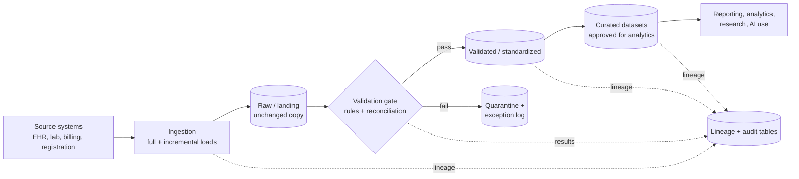

# Reference architecture: where the checks fit in a healthcare data pipeline

This is a **generic, vendor-neutral pattern**, not a certified design. It shows where each part of this toolkit sits. A real design depends on the organization's systems, privacy and security obligations, and the standards it uses. Review it with your own technical, privacy and compliance staff.

## Layers

| Layer | Purpose | Toolkit component |
|---|---|---|
| Ingestion | Move data from sources; full and incremental loads | `check_incremental` (watermark safety checks), `sql/06_incremental_watermark.sql` |
| Raw / landing | Keep an unchanged copy so any result can be traced back | `reconcile` (source vs landing counts, keys, totals) |
| Validation gate | Decide whether a batch may move forward | `rules` (integrity), `reconcile` (completeness, value differences) |
| Quarantine | Hold failing records with the reason | `write_results` (audit table) |
| Validated / curated | Standardized, approved datasets | `reconcile` (landing vs curated), agreed definitions |
| Lineage and audit | Record what moved, when, by which rule | `LineageLog`, `sql/07_audit_and_lineage_tables.sql` |

## Which check answers which question

| Question | Check |
|---|---|
| Did everything arrive? | row count, missing and extra keys |
| Did anything arrive twice? | duplicate keys, unique rule |
| Did a value change in transit? | row-level hash, aggregate totals |
| Does every event belong to a real encounter and patient? | referential integrity |
| Are the values allowed and the dates in order? | allowed values, date order |
| Does the claim agree with the encounter? | amount matches parent |
| Did the incremental load skip late rows? | late-arriving check |
| Can I trace a number back to its source? | lineage log |

## Governance notes

- Run validation **before** curated data is released for analytics or AI use, and keep the results.
- Keep access to raw and quarantine layers narrower than access to curated data.
- This toolkit checks data reliability. It does not assess HIPAA, USCDI conformance, or any other legal or standards requirement, and it makes no clinical-quality claim.
- Standardized exchange (for example USCDI-aligned data) decides what is sent. These checks cover what happens to it after it lands in your own systems.
